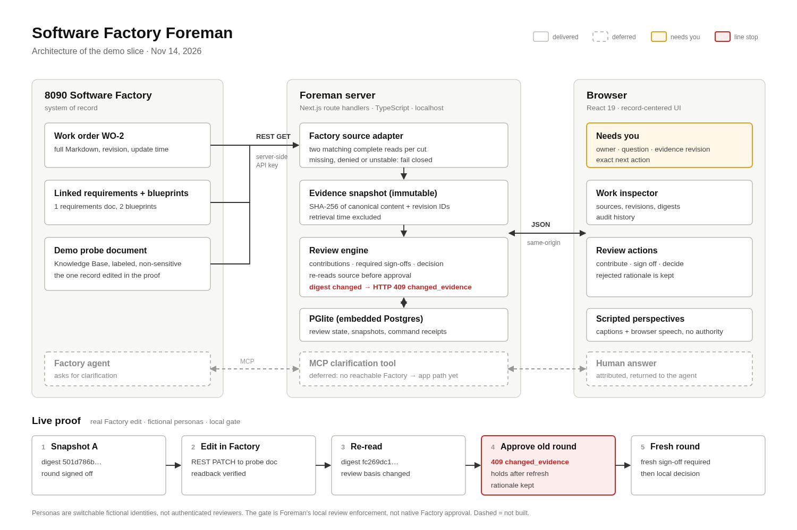

# Software Factory Foreman

Agents do the work. Foreman makes sure the right person signs off, on the version they actually read.

Built at EVOLVE: 8090 AI Hackathon, Nov 13–14, 2026.



## What it does

- **Needs you:** each open obligation shows owner, question, evidence revision and the exact next action.
- **Review rounds:** contributions, required sign-offs and the final decision are separate, attributed records.
- **Evidence from Software Factory:** a server-side adapter reads a work order and its directly linked requirements, blueprints and Knowledge Base documents through the external API, then stores an immutable snapshot with a canonical SHA-256 digest.
- **Line stop:** if the source changes after sign-off, approval returns HTTP 409 `changed_evidence`. The attempted rationale is kept. A fresh round with fresh sign-offs is required.

Demo story (fictional): a subscription business wants renewal discounts raised from 15% to 20%; policy and operations disagree on custom payment terms. Maya (Sales Ops), Alex (Finance) and River (Engineering) are scripted personas with captions and optional browser speech.

## Live proof

A real edit to a labeled, non-sensitive Software Factory demo document changed the review basis from `501d786b…` to `fc269dc1…`. Approving the old round returned 409 `changed_evidence`, before and after refresh. A fresh round required fresh sign-off. Details: [docs/api-ui-delivery.md](docs/api-ui-delivery.md), sanitized proof: [docs/evidence/factory-live-proof.json](docs/evidence/factory-live-proof.json).

## Limits

- Personas are switchable fictional identities, not authenticated or independent reviewers.
- The gate is this app's local review enforcement, not native Software Factory approval.
- The API key acts as its creator; no per-user source access.
- MCP clarification (agent asks, human answers, agent uses the answer) is **not built**: no reachable Factory → app path was available.
- The renewal rule (standard 20%, custom 15%, unknown rejected) is a prepared, tested example, not generated by approval and not connected to billing.
- Local only. No deployment.

## Run

Fixture mode (no credentials):

```sh
npm ci
npm run dev:fixture
# http://localhost:3000
```

Software Factory evidence mode (localhost only; key from a secure environment, never committed):

```sh
FACTORY_MODE=fixture FACTORY_SOURCE=api \
FACTORY_API_KEY=... \
FACTORY_WORK_ORDER_ID=<work order uuid> \
FACTORY_SUPPLEMENTAL_IDS=<optional demo document uuids> \
FACTORY_DATA_DIR=.data/api-demo \
./node_modules/.bin/next dev --hostname 127.0.0.1 --port 3002
```

See [.env.example](.env.example). `scripts/prove-factory-loop.mjs` reproduces the live proof; its edit step requires `FACTORY_ALLOW_DEMO_PROBE_EDIT=1` and touches only the configured demo document.

The original walkable pixel-art factory floor is still available from the UI (WASD / arrows, E to inspect).

## Verify

```sh
npm run typecheck
npm test            # 83 unit/service tests at cc62da0
npm run build
npm run test:e2e    # 14 browser journeys at cc62da0
```

Unit/service tests that cover the API adapter use mocks. The live API proof is separate. Results and source hashes: [docs/evidence/api-ui-verification.json](docs/evidence/api-ui-verification.json).

## Stack

Next.js 16, React 19, TypeScript, PGlite (embedded Postgres), Vitest, Playwright, GitHub Actions.

## Disclosures

### Libraries

| Library | License |
|---|---|
| Next.js, React, React DOM | MIT |
| PGlite (`@electric-sql/pglite`) | Apache-2.0 |
| TypeScript | Apache-2.0 |
| Playwright | Apache-2.0 |
| Vitest | MIT |

Full locked-dependency inventory: [docs/third-party-notices.md](docs/third-party-notices.md). Third-party packages keep their own licenses.

### APIs

| API | Use |
|---|---|
| 8090 Software Factory external API | Server-side reads of work orders, requirements, blueprints and Knowledge Base artifacts; one PATCH to a labeled demo document in the proof script. Subject to 8090's terms. |
| Web Speech API | Optional browser/OS speech for scripted personas. No voice assets distributed. |

### AI tools

| Tool | Use |
|---|---|
| 8090 Software Factory agents | Planning (requirements, blueprints, work orders), code, tests and docs, with one integrating agent and bounded parallel workers. A build method, not a runtime feature. |

### Sponsor tools

None. HydraDB, Composio, Vercel and ElevenLabs were not used.

### Pre-event work

- Hacking started Fri Nov 13, 7:10 PM PT. The first code commit is `a80e2c9`, Nov 14, 2:02 AM PT. The only earlier commit is a one-line README title (Nov 14, 1:59 AM PT).
- The Software Factory project workspace and its default template documents were created Nov 13, 10:20 AM PT, before the event. No project code predates the event.
- [OWNER TO CONFIRM: any idea or research files prepared before the event.]

## License

[MIT](LICENSE), copyright 2026 dryprogrammer.
